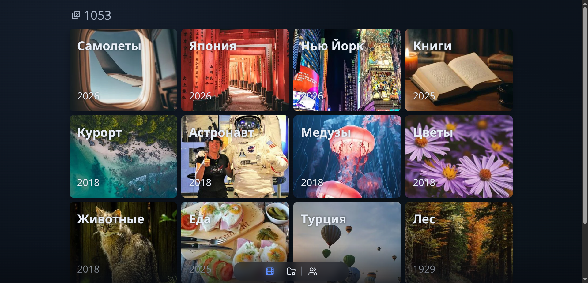
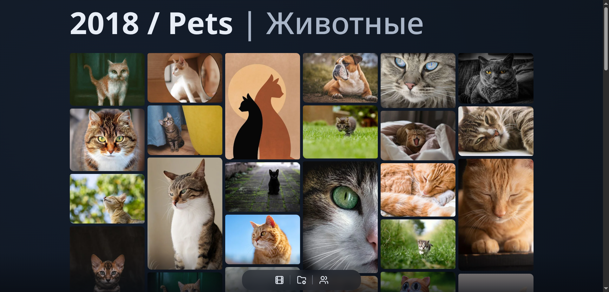
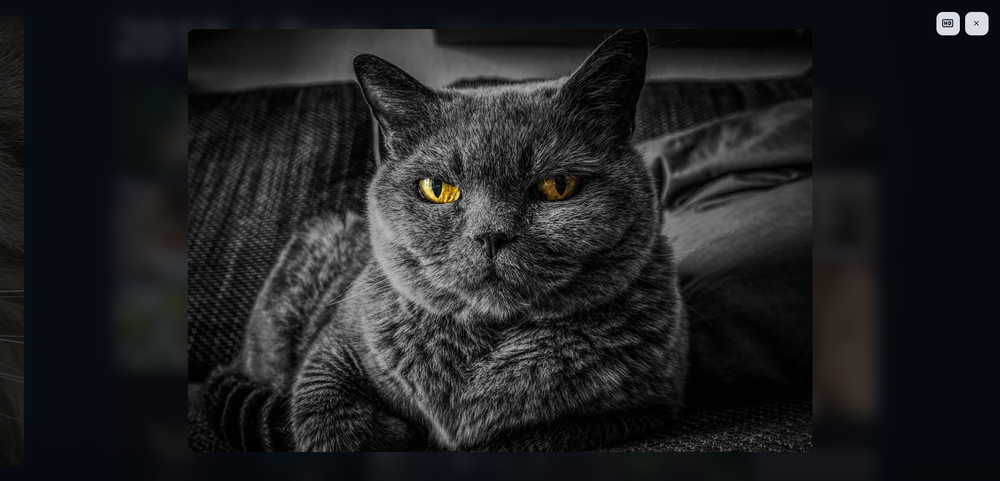
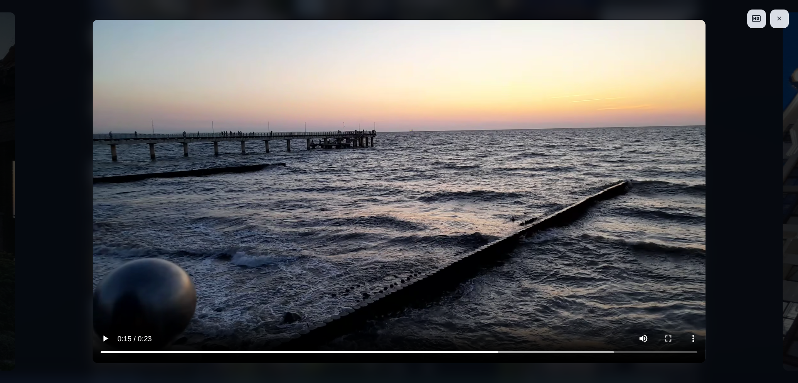
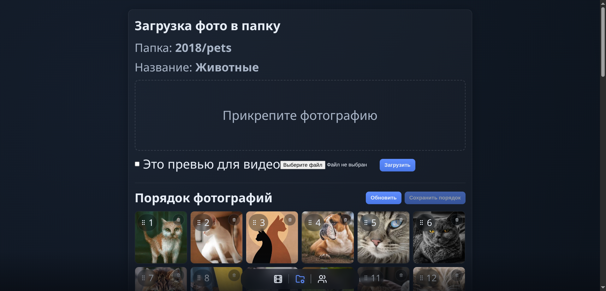
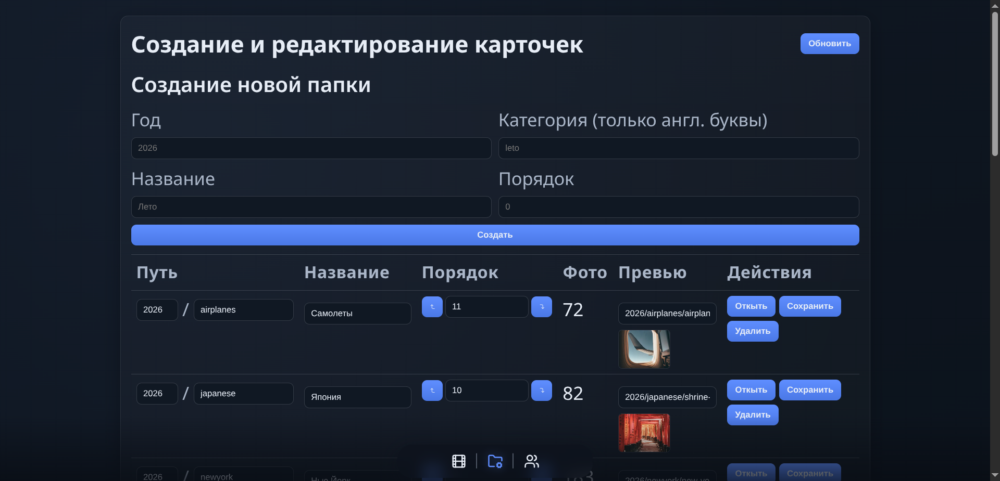
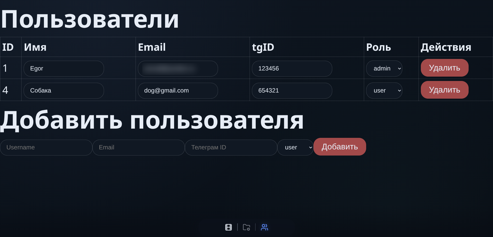
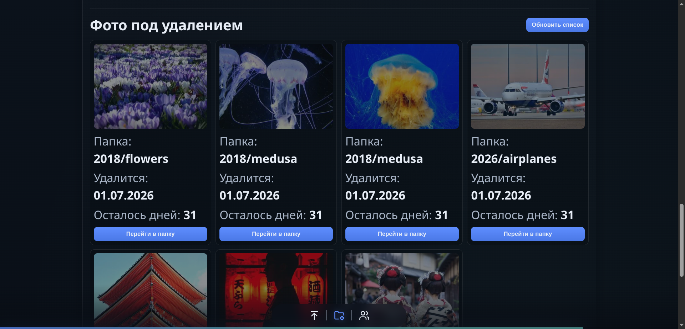

# Private Gallery

[English version](README.en.md)

**Личная медиагалерея, которую вы контролируете полностью.**

Фото, видео, папки, пользователи и доступы - на вашем сервере, в вашем хранилище, по вашим правилам. Без публичных фотоплатформ, без привязки к чужому облаку, без лишнего шума.

Private Gallery родилась как проект для себя: быстрый, закрытый и удобный архив личных медиа. Сейчас это уже хорошая основа для кастомного решения под клиента: семейной галереи, закрытого портфолио, личного архива, приватной медиатеки или self-hosted продукта для небольшой команды.

## Зачем

Обычные фотосервисы удобны, пока вы согласны жить внутри их правил. Private Gallery решает другую задачу: дать владельцу красивый интерфейс и полный контроль над данными.

- Храните медиа в S3-compatible storage, который выбираете сами.
- Показывайте фото и видео только авторизованным пользователям.
- Управляйте папками, пользователями и порядком контента из админки.
- Открывайте оригиналы через временные signed URLs.
- Деплойте проект на свой сервер через Docker Compose.

## Что Уже Есть

### Галерея Для Фото И Видео

Карточки папок на главной, masonry-витрина внутри папки, лайтбокс на Swiper, keyboard navigation, HD-кнопка для оригинала и воспроизведение видео через подготовленные S3-варианты.

### Приватность По Умолчанию

Сессии в PostgreSQL, HTTP-only secure cookies, CSRF-защита, роли `user` / `admin`, проверка приватных API routes, вход через Google, Telegram и Яндекс для заранее добавленных пользователей.

### Админка, Которая Закрывает Реальные Сценарии

Можно создавать и редактировать папки, менять обложки, управлять пользователями, загружать новые изображения, отмечать preview для видео, менять порядок медиа drag-and-drop и удалять контент без ручной работы с файлами.

Правки пользователей сохраняются одной кнопкой «Сохранить», а при уходе со страницы с несохранёнными изменениями появляется предупреждение. Раздел «Статистика» показывает, кто имеет доступ, когда и откуда последний раз входил, был ли недавно в галерее, сколько загрузил фото и сколько у него открытых сессий (их можно завершить). Раздел «Журнал» хранит все действия вошедших пользователей и все попытки входа (IP, устройство, время) с поиском и фильтрами; запросы ботов без входа не записываются.

### Умная Работа С Медиа

Оригиналы остаются отдельно, а для просмотра создаются легкие WebP-версии: `preview`, `screen-1280`, `screen-1920`, `screen-2560`. Галерея использует local cache, чтобы быстрее показывать уже открытые папки.

Поддерживаемые форматы загрузки: JPEG, PNG, WEBP, AVIF, GIF, TIFF, HEIC/HEIF с iPhone и RAW камер (Sony ARW, Canon CR2/CR3, Nikon NEF, DNG, Fujifilm RAF, Olympus ORF, Panasonic RW2 и другие). HEIC переводится утилитой `heif-dec` (libheif), RAW — `dcraw_emu` (LibRaw) с половинным разрешением, которого хватает для всех вариантов просмотра. Оригинал хранится как есть, кнопка HD отдаёт именно его.

### Безопасное Удаление

Удаление работает мягко: медиа скрывается из галереи, остается доступным в edit mode, может быть восстановлено и удаляется окончательно только после retention period. Есть отдельный экран со всеми файлами, ожидающими удаления.

### Фоновая Обработка

Загрузка, сортировка и soft delete уходят в фоновый worker через очередь в PostgreSQL. Reorder не просто меняет UI: система переименовывает связанные S3-версии, проверяет hash и показывает статус выполнения.

## Почему Это Сильная Основа Для Клиента

Private Gallery закрывает не только красивый просмотр, но и владение системой целиком. Клиент получает понятный продукт: private-first галерею, которую можно развернуть, адаптировать под бренд, расширить под нужный workflow и не зависеть от потребительских облачных фотосервисов.

Проект уже содержит то, что обычно приходится дописывать после первого демо: авторизацию, роли, админку, хранение, оптимизированные версии файлов, фоновые задачи, мягкое удаление и repeatable deploy.

## Скриншоты

<table>
  <tr>
    <td width="50%">
      
      <br />
      <sub><strong>Главная.</strong> Папки с обложками, годами и счетчиком медиа.</sub>
    </td>
    <td width="50%">
      
      <br />
      <sub><strong>Папка.</strong> Быстрая masonry-витрина для просмотра коллекции.</sub>
    </td>
  </tr>
  <tr>
    <td width="50%">
      
      <br />
      <sub><strong>Фото.</strong> Лайтбокс со слайдером и открытием оригинала.</sub>
    </td>
    <td width="50%">
      
      <br />
      <sub><strong>Видео.</strong> Просмотр видео через приватные signed URLs.</sub>
    </td>
  </tr>
  <tr>
    <td width="50%">
      
      <br />
      <sub><strong>Редактор папки.</strong> Upload, preview, сортировка и удаление.</sub>
    </td>
    <td width="50%">
      
      <br />
      <sub><strong>Папки.</strong> Создание, порядок, обложки и названия.</sub>
    </td>
  </tr>
  <tr>
    <td width="50%">
      
      <br />
      <sub><strong>Пользователи.</strong> Email, Telegram ID и роли доступа.</sub>
    </td>
    <td width="50%">
      
      <br />
      <sub><strong>Soft delete.</strong> Все файлы, ожидающие финального удаления.</sub>
    </td>
  </tr>
</table>

## Под Капотом

```text
Browser
  |
  v
Caddy / HTTPS (Let's Encrypt)
  |
  +-- React frontend (статика)
  |
  +-- /api -> Express API
        |
        +-- PostgreSQL: users, sessions, cards, размеры медиа
        +-- Redis: кэш листингов и индекса медиа
        +-- S3-compatible storage: originals, previews, videos
        +-- PostgreSQL-очередь -> worker: upload, reorder, soft delete
```

## Стек

- **Frontend:** React 19, Vite, React Router, Swiper, DnD Kit, Lucide React, Sileo.
- **Backend:** Node.js, Express 5, PostgreSQL, `express-session`, `connect-pg-simple`, CSRF (HMAC-токен + Origin), Helmet, Multer, Sharp.
- **Storage & jobs:** S3-compatible storage, signed URLs, Redis cache, очередь задач в PostgreSQL.
- **Infra:** Docker Compose, Caddy, PostgreSQL, Redis.

## Хранение Медиа

Фото:

```text
original_photo/{year}/{category}/{name}.{ext}
preview/{year}/{category}/{name}.webp
screen-1280/{year}/{category}/{name}.webp
screen-1920/{year}/{category}/{name}.webp
screen-2560/{year}/{category}/{name}.webp
```

Видео:

```text
preview/{year}/{category}/video_{name}.webp
video_1440/{year}/{category}/{name}.mp4
video_1080/{year}/{category}/{name}.mp4
video_720/{year}/{category}/{name}.mp4
```

Видео-воспроизведение рассчитано на уже подготовленные MP4-варианты в S3-compatible storage. Сценарий загрузки в админке может загрузить preview image и отметить его как видео.

## Деплой На Ubuntu 24.04

### 1. Docker

```bash
sudo apt update
sudo apt install -y ca-certificates curl

sudo install -m 0755 -d /etc/apt/keyrings
sudo curl -fsSL https://download.docker.com/linux/ubuntu/gpg -o /etc/apt/keyrings/docker.asc
sudo chmod a+r /etc/apt/keyrings/docker.asc

sudo tee /etc/apt/sources.list.d/docker.sources <<EOF
Types: deb
URIs: https://download.docker.com/linux/ubuntu
Suites: $(. /etc/os-release && echo "${UBUNTU_CODENAME:-$VERSION_CODENAME}")
Components: stable
Signed-By: /etc/apt/keyrings/docker.asc
EOF

sudo apt update
sudo apt install -y docker-ce docker-ce-cli containerd.io docker-buildx-plugin docker-compose-plugin

docker -v
docker compose version

sudo systemctl start docker
sudo systemctl enable docker
```

### 2. Проект

```bash
sudo apt install -y git
git -v

git clone https://github.com/EgorBabin/private-gallery.git
cd private-gallery
ls -a
```

### 3. Переменные Окружения

```bash
cp .env.example .env
nano .env
```

Заполните основные значения:

- `SERVER_NAME`, `LE_EMAIL`, `FRONTEND_URL` - домен и HTTPS (сертификат выпускает Caddy, порты 80 и 443 должны быть открыты).
- `SESSION`, `SESSION_SECRET` - сессии.
- `S3_BUCKET`, `S3_REGION`, `S3_ENDPOINT`, `S3_ACCESS_KEY_ID`, `S3_SECRET_ACCESS_KEY` - S3-compatible storage.
- `PG_USER`, `PG_PASSWORD`, `PG_HOST`, `PG_PORT`, `PG_DATABASE` - PostgreSQL.
- `APP_INIT_*` - первый пользователь.
- `GOOGLE_*` - вход через Google. В Google Cloud Console создайте OAuth-клиент типа «Web application», укажите redirect URI `https://<домен>/api/google/callback`, в доступах оставьте только `openid` и `email`. Почта ищется в том же массиве `email` пользователя, что и для Яндекса.
- `YANDEX_*` - Yandex OAuth.
- `TG_BOT_TOKEN`, `TG_CHAT_ID` - вход через Telegram и уведомления. Домен сайта нужно указать боту в BotFather командой `/setdomain`.

### 4. Права Docker

```bash
sudo usermod -aG docker [your_linux_username]
newgrp docker
```

### 5. Запуск

```bash
docker compose build
docker compose up -d
docker compose ps -a
```

Логи:

```bash
docker compose logs -f --tail=200 backend photo-worker
```

Логи контейнеров ротируются автоматически (до 3 файлов по 10 МБ на контейнер), у каждого сервиса есть лимит памяти, а у `photo-worker` ещё и лимит CPU. Значения по умолчанию можно поменять в `.env` (блок `container resource limits`).

### 6. Обновление

```bash
git pull
docker compose build
docker compose up -d
docker image prune -f
docker builder prune -f
```

Последние две команды удаляют старые образы и кэш сборки. Без них каждая пересборка оставляет на диске сотни мегабайт.

> **Переход с версии на Traefik + nginx + RabbitMQ.** Обновляйтесь, когда нет загрузок в обработке: задачи из старой очереди RabbitMQ не переносятся. Старые контейнеры удаляются флагом `--remove-orphans`, Caddy при первом запуске сам выпустит новый сертификат:
>
> ```bash
> docker compose up -d --build --remove-orphans
> docker volume rm private-gallery_rabbitmqdata private-gallery_traefik-letsencrypt
> ```

### 7. Приватность

- Caddy отдаёт Content-Security-Policy, `Referrer-Policy: strict-origin-when-cross-origin` (в S3 и на чужие сайты уходит только домен, без названий папок) и `X-Robots-Tag: noindex`. Укажите `S3_PUBLIC_ORIGIN` в `.env`, чтобы картинки и видео разрешались только с вашего хранилища.
- Сессия не привязана к IP (`SESSION_BIND_IP=false`), иначе телефон выкидывает при смене сети. CSRF-защита: HMAC-токен сессии и проверка `Origin`. API ограничен по частоте запросов с одного IP.
- Координаты съёмки (GPS) можно удалить из оригиналов, не повреждая файлы: блок GPS затирается на месте, изображение, поворот, дата, камера и остальные метаданные остаются. Поддерживаются JPEG, PNG, TIFF, HEIC/HEIF и RAW (в том числе CR3). Для новых загрузок — `STRIP_GPS_ON_UPLOAD=true`, для уже загруженных — скрипт (сначала проверка, потом очистка):

```bash
docker compose run --rm photo-worker node scripts/stripLocation.js
docker compose run --rm photo-worker node scripts/stripLocation.js --apply
```

## Для Кого

- Личная self-hosted галерея.
- Семейный или travel archive.
- Закрытое портфолио.
- Private client preview для фотографов, дизайнеров и студий.
- База для кастомного media-management решения.

## Лицензия

Проект опубликован под MIT License. См. [LICENSE](LICENSE).

# Made with ❤️